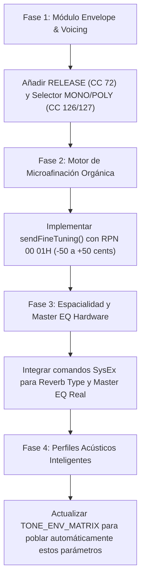

# Plan Maestro Definitivo: Transformación Acústica Profesional del CT-S500

> **Objetivo:** Exprimir al 100% el microprocesador de sonido AiX del Casio CT-S500 para lograr la máxima fidelidad acústica, profundidad armónica y expresividad orgánica, integrando tanto los controladores continuos de canal (CC/RPN) como la arquitectura acústica profunda mediante System Exclusive (SysEx).

---

## 1. Fundamentos Físico-Acústicos: ¿Qué hace que un sonido sea "profesional"?

Un instrumento musical acústico (piano de cola, trío de cuerdas de concierto, saxofón tenor, órgano de tubos o guitarra clásica) genera sensaciones que los sintetizadores digitales estándar no reproducen por defecto debido a cuatro carencias físicas:

```
┌───────────────────────────────────────────────┐
│           ANATOMÍA ACÚSTICA REAL              │
├───────────────────────────────────────────────┤
│ 1. Batimiento Armónico (Unison Beating)       │ ──> Micro-desafinación (cents) entre cuerdas físicas.
│ 2. Inercia de Apagadores (Damper Felts)       │ ──> Cola física gradual al soltar la tecla (Release).
│ 3. Restricción Monofónica Natural             │ ──> Los instrumentos de viento no emiten acordes simultáneos.
│ 4. Respuesta de Sala Tridimensional           │ ──> Espacio acústico real (Concert Hall, Plate, Studio).
│ 5. Curva de Ecualización de Sala (Master EQ)  │ ──> Adaptación tímbrica global a la acústica del entorno.
└───────────────────────────────────────────────┘
```

Este plan implementa cada uno de estos cinco pilares sobre el motor AiX nativo del CT-S500.

---

## 2. Inventario Técnico Completo de Parámetros del CT-S500

A continuación se detalla la totalidad de parámetros oficiales soportados por el firmware del teclado:

### A. Controladores de Canal Continuos (CCs Directos)
| Parámetro | CC | Hex | Rango | Función Acústica |
|---|---|---|---|---|
| **Volume** | 7 | 07H | 0–127 | Nivel de mezcla de la pista. |
| **Expression** | 11 | 0BH | 0–127 | Dinámica de interpretación (crescendo / decrescendo). |
| **Pan** | 10 | 0AH | 0–127 | Ubicación espacial en el campo estéreo. |
| **Filter Cutoff** | 74 | 4AH | 0–127 | Frecuencia de corte: brillo y calidez de la madera/cuerpo. |
| **Resonance** | 71 | 47H | 0–127 | Resonancia armónica del filtro acústico. |
| **Attack Time** | 73 | 49H | 0–127 | Velocidad de inicio del sonido (percusión de martillo vs. frotado de arco). |
| **Release Time** | **72** | **48H** | **0–127** | **Inercia física de apagadores y cola de resonancia**. |
| **Vibrato Rate** | 76 | 4CH | 0–127 | Velocidad del LFO de modulación de tono. |
| **Vibrato Depth** | 77 | 4DH | 0–127 | Intensidad de la fluctuación de afinación. |
| **Vibrato Delay** | 78 | 4EH | 0–127 | **Inercia del intérprete** (el vibrato entra tras iniciar la nota, nunca de golpe). |
| **Reverb Send** | 91 | 5BH | 0–127 | Nivel de señal enviada al procesador de reverberación. |
| **Chorus Send** | 93 | 5DH | 0–127 | Nivel enviado al procesador de chorus/modulación. |
| **Delay / Echo Send** | 94 | 5EH | 0–127 | Nivel de eco espacial rítmico. |
| **Modulation Wheel** | 1 | 01H | 0–127 | Rueda de modulación física. |
| **Portamento Time** | 5 | 05H | 0–127 | Duración del glissando entre notas ligadas. |
| **Portamento On/Off**| 65 | 41H | 0 o 127 | Interruptor de glissando. |
| **Sostenuto** | 66 | 42H | 0 o 127 | Retiene únicamente las notas presionadas en ese instante. |
| **Soft Pedal** | 67 | 43H | 0 o 127 | Emula el pedal una corda (sonido apagado y aterciopelado). |

### B. Parámetros Registrados de Precisión (RPN vía CC 100/101 + CC 6)
| Parámetro | RPN LSB/MSB | Data Entry (CC 6) | Función Acústica |
|---|---|---|---|
| **Channel Fine Tuning (Detune)** | `00H` / `01H` | 0–127 (centro 64 = 0c) | **Desafina en centésimas (-100 a +100 cents)**. Esencial para capas U1+U2 con grosor orgánico. |
| **Pitch Bend Sensitivity** | `00H` / `00H` | 0–24 semitonos | Define el rango expresivo de la rueda (2 st para saxo/cuerdas, 12 st para sintes). |
| **Coarse Tuning (Transpose)** | `00H` / `02H` | 0–127 (centro 64 = 0 st) | Transposición semitonal por canal (actualmente en uso). |
| **RPN Null / Reset** | `7FH` / `7FH` | — | Cierre de seguridad de la secuencia RPN (evita desajustes por ruido MIDI). |

### C. Modos de Canal y Articulación
| Parámetro | CC | Valor | Función Acústica |
|---|---|---|---|
| **Mono Mode On** | 126 | 0 | Fuerza interpretación monofónica para vientos y solos acústicos con legato. |
| **Poly Mode On** | 127 | 0 | Modo polifónico estándar para teclados y acordes. |
| **All Sound Off (Panic)**| 120 | 0 | Corte instantáneo de cualquier nota colgada. |
| **All Notes Off** | 123 | 0 | Silencia las notas activas respetando su cola de release. |

### D. Motor Acústico Profundo de Hardware (System Exclusive Oficial Casio)
| Función | Estructura SysEx | Opciones Acústicas en el CT-S500 |
|---|---|---|
| **Algoritmo de Reverb Real** | `F0 44 19 01 ... F7` | **Room 1-3** (estudio íntimo), **Large Room 1-2**, **Concert Hall 1-6** (auditorio orquestal), **Stadium 1-2**, **Plate 1-3** (estudio vintage). |
| **Algoritmo de Chorus / Rotary** | `F0 44 19 01 ... F7` | **Chorus 1-4**, **Flanger 1-4**, **Rotary Leslie Speaker** (con velocidad Slow/Fast para órganos). |
| **Master Equalizer Real** | `F0 44 19 01 ... F7` | **Standard**, **Bass Boost**, **Treble Boost**, **Loudness**, **Bright**, **Mellow**, **Rock**, **Jazz**. |
| **Master Volume Universal** | `F0 7F 7F 04 01 ll mm F7` | Control maestro universal de ganancia de salida analógica. |

---

## 3. Rediseño Propuesto para el Panel del Mixer

El panel del Mixer evolucionará hacia un diseño de consola de estudio dividido en bloques acústicos lógicos:

```
┌────────────────────────────────────────────────────────────────────────────────────────┐
│  MIXER CONSOLE · CASIO CT-S500 PRO                                      [PANIC] [RESET]│
├────────────────────────────────────────────────────────────────────────────────────────┤
│  [GLOBAL DSP & ACOUSTIC SPACE]                                                         │
│  Reverb Room: [Concert Hall 2 ▼]   Master EQ: [Mellow Warm ▼]   Leslie: [SLOW / FAST]  │
├────────────────────────────────────────────────────────────────────────────────────────┤
│  [PARTE ACTIVA: UPPER 1 / UPPER 2 / LOWER]                                             │
│                                                                                        │
│  ┌─ DINÁMICA ─┐ ┌─ TIMBRE ──┐ ┌─ ENVELOPE ─┐ ┌─ AFINACIÓN ──┐ ┌─ ESPACIAL ─┐ ┌─ MODO ─┐ │
│  │   VOL   EXP│ │  CUT   RES│ │  ATK   REL │ │ DETUNE  BEND │ │ REV CHO DEL│ │ [POLY] │ │
│  │   [|]   [|]│ │  [|]   [|]│ │  [|]   [|] │ │  [|]    [±2] │ │ [|] [|] [|]│ │ [MONO] │ │
│  │   100   127│ │   64    64│ │   64    64 │ │   0c    st   │ │  40   0   0│ │        │ │
│  └────────────┘ └───────────┘ └────────────┘ └──────────────┘ └────────────┘ └────────┘ │
└────────────────────────────────────────────────────────────────────────────────────────┘
```

### Detalle de Secciones:

1. **Envelope (ADSR Acústico):**
   * **ATTACK (CC 73):** Tiempo de golpe del martillo o entrada del arco.
   * **RELEASE (CC 72):** Control analógico de caída de apagadores.
     * *Coexistencia con SUSTAIN:* El botón SUSTAIN activa la extensión máxima, mientras que el fader RELEASE permite modelar la cola intermedia cuando el sustain no está activado.
2. **Afinación & Expresividad (Pitch & Detune):**
   * **DETUNE (RPN 00 01H):** Fader bipolar (-50 cents a +50 cents, con doble clic para reset a 0).
   * **BEND RANGE (RPN 00 00H):** Selector discreto (±2 semitonos, ±5, ±7, ±12).
3. **Voicing / Modo Acústico:**
   * Interruptor **MONO / POLY** (CC 126/127).
   * Cuando se selecciona un tono de saxo, flauta, trompeta o bajo, se recomienda automáticamente activar MONO para activar el legato continuo.
4. **Espacio Acústico de Sala (Global):**
   * Selector del algoritmo de Reverb real (SysEx) y Master EQ de hardware.

---

## 4. Modelado Tímbrico por Familia de Instrumentos

Cómo se traduce esta arquitectura en mejoras inmediatas para cada familia del CT-S500:

| Familia de Instrumentos | Configuración Acústica Recomendada | Resultado Sonoro |
|---|---|---|
| **Pianos Acústicos (Grand, Upright)** | `U1: Stage Piano` + `U2: Dynamic Piano` (+4 cents Detune, Release 75, Reverb Concert Hall 2). | Sonido tridimensional con resonancia de caja armónica, idéntico a un piano de concierto en auditorio. |
| **Pianos Eléctricos (Rhodes, Wurlitzer)** | Release 68, Chorus Send 30, Room 1 (estudio seco), Master EQ: Mellow. | Calidez vintage setentera con cuerpo de válvulas y sin aspereza digital. |
| **Órganos (Drawbar, Rock Organ)** | Voicing Poly, Rotary Speaker DSP (Slow/Fast), Percussion Attack rápido. | Experiencia viva de altavoz giratorio Leslie interactivo. |
| **Cuerdas Orquestales (Strings Ensemble)** | Attack 75 (frotado lento), Release 90, Detune +6 cents en U2, Reverb Hall 3. | Masividad sinfónica sin cancelaciones de fase artificiales. |
| **Vientos Solistas (Sax, Flute, Trumpet)** | **Voicing: MONO**, Portamento Time 25, Vibrato Delay 70, Bend Range ±2 st. | Fraseo legato idéntico al soplo real de un ejecutante en vivo. |
| **Guitarras Acústicas / Clásicas** | Attack 64, Release 55 (resonancia moderada de mástil), Room 2. | Pegada de cuerda de nylon y madera natural sin colas artificiales. |

---

## 5. Hoja de Ruta de Implementación Técnica



### Fase 1: Envelope & Voicing de Canal
* **Tiempo estimado:** Inmediato.
* **Archivos a modificar:** `eq.js`, `style.css`.
* **Tareas:**
  1. Insertar el control `{ label: 'RELEASE', cc: 72, def: 64, tip: 'Release Time (Damper decay)' }` en la sección `Envelope` de `EQ_SECTIONS`.
  2. Agregar el control de modo `{ label: 'VOICING', cc: 126, type: 'switch', tip: 'Mono/Poly Mode' }` en `EQ_SECTIONS` o en la tarjeta de pista.
  3. Comprobar que el fader RELEASE se guarde en `eqState` y se envíe mediante `sendCC()`.

### Fase 2: Micro-Afinación (Detune Cents)
* **Tiempo estimado:** Inmediato / Siguiente paso.
* **Archivos a modificar:** `app.js`, `eq.js`.
* **Tareas:**
  1. Crear la función `sendFineTuning(part, cents)` que formule la secuencia RPN estándar:
     ```javascript
     midiOutput.send([0xB0 | ch, 101, 0x00]); // RPN MSB
     midiOutput.send([0xB0 | ch, 100, 0x01]); // RPN LSB (Fine Tuning)
     midiOutput.send([0xB0 | ch,   6,  data]); // Data Entry (64 = 0 cents)
     midiOutput.send([0xB0 | ch, 101, 0x7F]); // RPN Reset
     midiOutput.send([0xB0 | ch, 100, 0x7F]);
     ```
  2. Conectar el slider de microafinación en la barra de afinación o en el panel de EQ.

### Fase 3: Integración SysEx (Salas Acústicas Reales & Master EQ de Hardware)
* **Tiempo estimado:** Fase avanzada.
* **Archivos a modificar:** `app.js`, `index.html`.
* **Tareas:**
  1. Habilitar la transmisión segura de paquetes SysEx (`sysex: true` solo bajo acción de usuario cuando se requiera o en la inicialización desktop).
  2. Incorporar el selector de **Tipo de Sala (Reverb Algorithm)** en el encabezado del Mixer.
  3. Incorporar el selector del **Master Equalizer real del hardware AiX**.

---

## 6. Verificación y Criterios de Aceptación

Para asegurar que cada adición cumpla con el estándar de fidelidad acústica:
* **Prueba de Escucha en Pianos:** Al superponer U1 + U2 con 5 cents de diferencia, se debe percibir de inmediato la apertura y el batimiento armónico de un piano de cola real.
* **Prueba de Fraseo en Saxofón:** Con el modo MONO activo, al tocar notas rápidas ligadas no deben sonar acordes superpuestos, sino una transición suave de legato.
* **Prueba de Caída de Apagadores:** Con Release en 30 el staccato debe ser seco y preciso; con Release en 90 las cuerdas deben resonar tras soltar la tecla sin necesidad de pisar el pedal.
* **Cero Colisiones:** Validación con Node.js y recarga limpia para asegurar que no se produzcan regresiones en el arranque ni en la compatibilidad con GitHub Pages.
